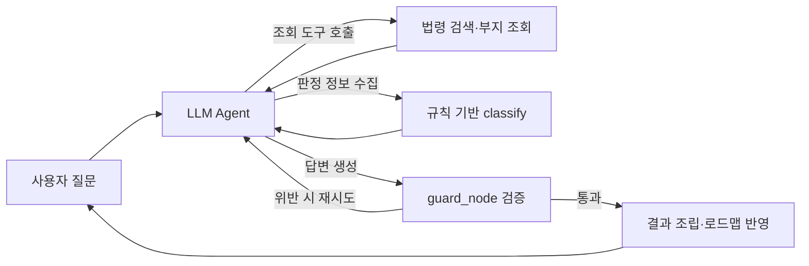

# 창업 로드맵 어시스턴트

**서울시 카페·음식점 창업에 필요한 인허가 절차를 하나의 로드맵으로 안내하는 AI 서비스**

건축물의 용도변경부터 식품위생 영업신고, 소방시설, 간판, 사업자등록까지. 창업자가 여러 법령과 행정 절차를 따로 찾아보지 않도록 **조건별 절차를 판정하고 단계별로 안내**합니다.

**핵심 설계 원칙:** 허가·신고 여부처럼 법적 요건으로 결정되는 값은 Python 규칙 함수가 판정하고, LLM은 검색된 법령 근거를 바탕으로 그 결과와 다음 절차를 설명합니다.

    

## 데모

https://github.com/user-attachments/assets/e87e592c-a873-43dc-90f8-827c80a101b9

**시연 흐름**
1. 창업·건축 조건을 입력하고 필요한 정보를 확인합니다.
2. AI 어시스턴트가 인허가 유형을 확인하고 단계별 절차를 안내합니다.
3. 법령 근거와 함께 로드맵의 현재 단계 및 다음 할 일을 확인합니다.
4. 완료한 작업을 체크하고 진행 상황을 관리합니다.

## 주요 기능

| 기능 | 설명 |
|---|---|
| **규칙 기반 인허가 판정** | 건축 허가·신고·기재변경, 식품위생 영업 유형, 소방시설, 옥외광고물 관련 판정을 코드로 계산합니다. |
| **법령 근거 검색(RAG)** | 법률·시행령·시행규칙·조례에서 관련 조항을 검색하고 리랭킹해 답변에 활용합니다. |
| **통합 창업 로드맵** | 건축 인허가는 순서대로, 독립적으로 준비할 수 있는 창업 업무는 병렬로 관리합니다. 선행 절차가 필요한 항목은 잠금 상태로 표시합니다. |
| **대화 답변 검증** | `guard_node`가 판정 전 단계 안내, 근거 없는 인용 등 규칙 위반을 검사하고 재시도를 유도합니다. |

추가로 주소 기반 부지·건축물대장 조회(VWorld·건축HUB), SQLite 대화 상태 저장, Gemini 할당량 소진 시 Cerebras 폴백, 변경 문서 증분 인덱싱을 지원합니다. 외부 API 조회는 별도 키 설정이 필요합니다.

## 서비스 절차

건축 인허가 트랙은 순차적으로 진행하고, 식품위생·소방·간판 등 창업 준비는 필요한 선행 조건을 고려해 병렬로 안내합니다.

| 단계 | 주요 안내 |
|---|---|
| **Step 0 · 상황 확인** | 신축·증축·용도변경 등 행위 유형 확인 |
| **Step 1 · 인허가** | 허가·신고·기재변경 판정, 서류 및 사전 검토 |
| **Step 2 · 공사** | 착공신고, 설계·감리, 시공, 사용승인 |
| **Step 3 · 창업 준비** | 식품위생 영업신고, 소방시설, 간판, 사업자등록, 위생교육 |
| **Step 4 · 영업 시작** | 직원 등록 및 오픈 준비 |

## 시스템 아키텍처

LLM이 도구를 선택해 정보를 모으는 **ReAct 루프**를 사용하지만, 법적 판정과 답변 검증은 독립된 코드 노드에서 실행합니다.



- **판정:** 면적·층수·시설군처럼 객관적 기준이 필요한 항목은 Python 규칙 함수에서 처리합니다.
- **검색:** 법령 문서를 구조에 맞게 청킹하고 임베딩 검색과 CrossEncoder 리랭킹으로 근거를 찾습니다.
- **검증:** 프롬프트만으로 막기 어려운 답변 오류를 LangGraph의 후처리 노드에서 검사합니다.

구체적인 설계 선택, 실험 및 트러블슈팅 기록은 [`docs/project_report.md`](docs/project_report.md)와 [`docs/adr/`](docs/adr/README.md)(결정별 ADR 15건)에서 볼 수 있습니다.

### 에이전트 구성 (`src/agents/`)

아직 별도 서브그래프ᆞ오케스트레이터 없이, 위 ReAct 루프가 아래 모듈들을 도구로 바인딩해 씁니다.

| 모듈 | 역할 |
|---|---|
| `site.py` | 용도지역·건폐율·용적률·건축물대장 자동 조회(API) |
| `permit.py` | 허가/신고/기재변경 판정(규칙 기반) + 절차 로드맵 |
| `food_safety.py` | 식품위생법상 영업 종류 판정(규칙 기반) |
| `fire_safety.py` | 소방시설 설치 대상 판정(규칙 기반) |
| `signage.py` | 간판·옥외광고물 허가/신고 판정(규칙 기반) |
| `construction.py` | 착공·설계·공사감리·사용승인 안내(정적/RAG 콘텐츠) |
| `business_registration.py` / `hygiene_education.py` | 사업자등록 / 위생교육 안내 |
| `opening_checklist.py` | 오픈 준비(인테리어·직원등록·영업시작) 체크리스트 |
| `roadmap_progress.py` | 사용자가 완료했다고 밝힌 항목 자기보고 추적 |
| `legal_data.py` | 법정 임계값(`permit_thresholds.yaml`) 로더 |

### 디렉터리 구조

```
permit-assistant/
├── src/
│   ├── agent.py / graph.py / routing.py   # LangGraph 조립·배선·분기
│   ├── classify.py / guard.py             # 판정 파이프라인 / 답변 검증
│   ├── agents/                            # 도메인별 에이전트 모듈(위 표)
│   ├── rag/                               # 청킹·검색·리랭킹·증분 인덱싱
│   └── static/                            # 웹 채팅 UI (/ui)
├── data/{laws,ordinances,procedures}/     # 법령·조례·절차 원문
├── docs/{adr,memory}/                     # 결정 기록(ADR) · 설계 문서
├── tests/                                 # pytest + Node.js subprocess(프론트 로직)
└── Dockerfile
```

## 로컬 실행

**요구 사항:** Python 3.11, [uv](https://docs.astral.sh/uv/), Gemini API 키. 초기 실행 시 임베딩·리랭커 모델 다운로드와 법령 인덱싱이 필요합니다.

```bash
# 1. 의존성 설치
git clone https://github.com/jenayang/permit-assistant.git
cd permit-assistant
uv sync --extra dev

# 2. 환경 변수 설정
cp .env.example .env
# .env 파일의 GEMINI_API_KEY에 본인 키 입력

# 3. 법령 검색 인덱스 생성 (최초 1회)
uv run python -m src.pipeline --ingest

# 4. 웹 서버 실행
uv run uvicorn src.api:app --reload
```

- **웹 UI:** http://localhost:8000/ui
- **API 문서:** http://localhost:8000/docs

CLI와 테스트 실행:

```bash
uv run python -m src.pipeline --query "강남구에서 카페를 창업하려면?"
uv run python -m src.pipeline --interactive --user demo
uv run pytest
```

선택 환경 변수: `CEREBRAS_API_KEY`(LLM 폴백), `VWORLD_API_KEY`·`VWORLD_DOMAIN`(부지 조회), `ARCHHUB_SERVICE_KEY`(건축물대장 조회). 자세한 설정 값은 [`.env.example`](.env.example)을 참조하세요.

Docker로 실행하려면:

```bash
docker build -t permit-assistant .
docker run -p 8000:8000 -e GEMINI_API_KEY=발급받은키 permit-assistant
```

## 포함된 법령·조례

[`data/`](data/)에는 건축 인허가와 창업 관련 법령·조례·절차 안내 원문이 분야별로 수록되어 있습니다.

| 분야 | 주요 법령·자료 |
|---|---|
| **건축·도시계획** | 건축법 및 시행령·시행규칙, 건축물의 설비기준 등에 관한 규칙, 국토의 계획 및 이용에 관한 법률 |
| **식품위생** | 식품위생법 및 시행령·시행규칙 |
| **소방·다중이용업소** | 소방시설 설치 및 관리에 관한 법률·시행령, 다중이용업소의 안전관리에 관한 특별법 |
| **간판·옥외광고물** | 옥외광고물 등의 관리와 옥외광고산업 진흥에 관한 법률·시행령 |
| **편의시설·정화조** | 장애인·노인·임산부 등의 편의증진 보장에 관한 법률·시행령, 하수도법, 오수발생량·정화조 산정방법 |
| **사업자·고용** | 부가가치세법·시행령, 고용보험법, 국민건강보험법, 국민연금법, 고용·산재보험료징수법 |
| **서울시 조례·지역 기준** | 서울시 건축·도시계획·주차장·옥외광고물 조례, 관련 별표·서식 및 강남구 옥외광고물 수수료 별표 |

원문: [`data/laws/`](data/laws/), [`data/ordinances/`](data/ordinances/), [`data/procedures/`](data/procedures/) · 문서 출처: [`docs/data_sources.md`](docs/data_sources.md)

> 원문은 저장소에 포함된 파일 버전을 기준으로 하며, 최신 개정 법령 자동 반영이나 실제 행정기관 판정을 보장하지 않습니다. 원문 파일 존재와 로컬 검색 인덱스 구축 완료는 별개입니다.

## 프로젝트 문서

| 문서 | 내용 |
|---|---|
| [`docs/adr/`](docs/adr/README.md) | 트러블슈팅·아키텍처 결정 기록(ADR, 15건) |
| [`docs/project_report.md`](docs/project_report.md) | 설계 배경, 오류 재현, 실험 및 기술적 의사결정 |
| [`docs/phase1_roadmap.md`](docs/phase1_roadmap.md) | 개발 진행 현황과 다음 작업 |
| [`docs/data_sources.md`](docs/data_sources.md) | 법령 자료 출처 및 수집 방식 |
| [`docs/README.md`](docs/README.md) | 전체 문서 안내 |

**기술:** Python · FastAPI · LangGraph · Gemini · Cerebras · ChromaDB · HuggingFace Embeddings · CrossEncoder · SQLite · pytest · Docker

---

Developed by [jenayang](https://github.com/jenayang) · KakaoTech Bootcamp
